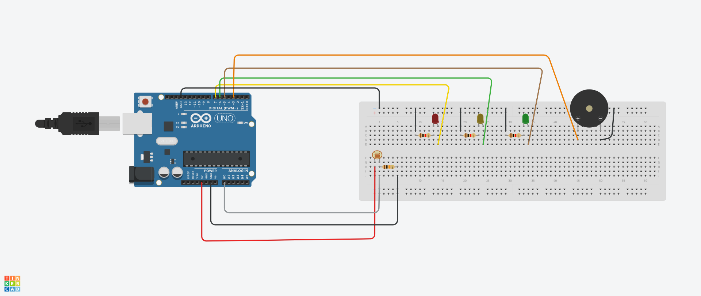
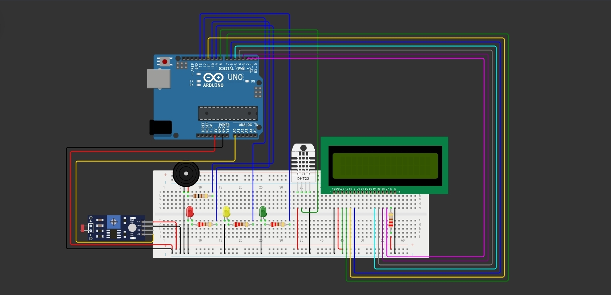
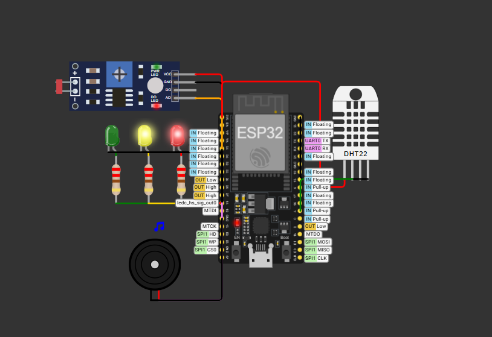

# 🍷 Vinheria Agnello — Sistema de Monitoramento de Luminosidade

> Projeto desenvolvido como parte da disciplina de Edge Computing & Computer Systems.  
> Monitora luminosidade, temperatura e umidade do ambiente de armazenamento de vinhos, acionando alertas visuais e sonoros em tempo real.

---

## 📌 Descrição do projeto

O vinho é sensível a três fatores ambientais principais: **luminosidade**, **temperatura** e **umidade**. A exposição excessiva à luz degrada compostos orgânicos; variações de temperatura causam aromas indesejados; e umidade fora da faixa ideal compromete vedantes e rótulos.

Este sistema monitora continuamente esses três fatores e responde de forma automática, acionando LEDs e buzzer conforme os níveis detectados.

---

## Faixas ideais de armazenamento

| Fator | Faixa Ideal | Fonte |
|---|---|---|
| Temperatura | 10°C a 15°C | Alexander Pandell, PhD — UC |
| Umidade | 50% a 70% | Recomendação geral |
| Luminosidade | Ambiente escuro/penumbra | — |

---

## 🔴 Lógica de alertas

### Luminosidade

| Estado | Condição | LED | Buzzer | Display |
|---|---|---|---|---|
| ✅ Adequado | Ambiente escuro | 🟢 Verde | Desligado | — |
| ⚠️ Alerta | Meia luz | 🟡 Amarelo | Desligado | `Ambiente a meia luz` |
| 🚨 Crítico | Muito claro | 🔴 Vermelho | Contínuo | `Ambiente muito claro` |

### Temperatura

| Estado | Condição | LED | Buzzer | Display |
|---|---|---|---|---|
| ✅ OK | Entre 10°C e 15°C | 🟢 Verde | Desligado | `Temperatura OK` + valor |
| ⚠️ Alta | Acima de 15°C | 🟡 Amarelo | Contínuo | `Temp. ALTA` + valor |
| ⚠️ Baixa | Abaixo de 10°C | 🟡 Amarelo | Contínuo | `Temp. BAIXA` + valor |

### Umidade

| Estado | Condição | LED | Buzzer | Display |
|---|---|---|---|---|
| ✅ OK | Entre 50% e 70% | 🟢 Verde | Desligado | `Umidade OK` + valor |
| ⚠️ Alta | Acima de 70% | 🔴 Vermelho | Contínuo | `Umidade ALTA` + valor |
| ⚠️ Baixa | Abaixo de 50% | 🔴 Vermelho | Contínuo | `Umidade BAIXA` + valor |

> O display LCD é usado apenas no segundo circuito.

---

## 1️⃣ Primeiro circuito (luminosidade)



> Simulação montada no **Tinkercad**. O LDR lê a luminosidade e envia o sinal analógico à porta `A0` do Arduino, que processa e aciona os componentes conforme os limiares definidos no código.

🔗 [Acessar simulação no Tinkercad](https://www.tinkercad.com/things/iGE2alnjSsO-cp-vinheria-agnello)

[](https://youtu.be/E_VeabWIuwE?si=LpvlSQirIN8TYRqz)

### Componentes

| Componente | Quantidade | Pino no Arduino |
|---|---|---|
| Arduino Uno | 1 | — |
| Sensor LDR (fotoresistor) | 1 | A0 |
| Resistor 10 kΩ | 1 | Divisor de tensão com LDR |
| LED Verde (5 mm) | 1 | D5 |
| LED Amarelo (5 mm) | 1 | D6 |
| LED Vermelho (5 mm) | 1 | D7 |
| Resistores 220 Ω | 3 | Um por LED |
| Buzzer Passivo 5V | 1 | D3 |

### Como executar

**Tinkercad**

1. Acesse [tinkercad.com](https://www.tinkercad.com) e faça login ou crie uma conta gratuita.
2. Clique em "Criar" e selecione "Circuito".
3. Adicione os componentes: Arduino Uno, LDR, resistor 10kΩ, LEDs (verde, amarelo e vermelho), resistores 220Ω e Buzzer.
4. Monte as conexões conforme o esquema em `circuito-01.png`.
5. Clique em "Código" e selecione o modo "Texto".
6. Apague o código padrão e cole o conteúdo do arquivo `circuito-01.ino`.
7. Clique em "Iniciar Simulação".
8. Clique no LDR e arraste o controle de luminosidade para testar os diferentes estados.

**Wokwi**

1. Acesse [wokwi.com](https://wokwi.com) e faça login ou crie uma conta gratuita.
2. Clique em "New Project" e selecione "Arduino Uno".
3. No painel de componentes (botão "+"), adicione: LDR, resistor 10kΩ, LEDs (verde, amarelo e vermelho), resistores 220Ω e Buzzer.
4. Monte as conexões conforme o esquema em `circuito-01.png`.
5. No editor de código, apague o conteúdo padrão e cole o conteúdo do arquivo `circuito-01.ino`.
6. Clique em Play.
7. Clique no LDR e ajuste o controle de luminosidade para testar os diferentes estados.

**Hardware físico**

1. Monte o circuito na protoboard conforme o esquema em `circuito-01.png`.
2. Abra o arquivo `circuito-01.ino` no Arduino IDE.
3. Selecione a porta correta em `Ferramentas > Porta` e clique em Upload (Ctrl+U).
4. Abra o Monitor Serial (9600 baud) para acompanhar os valores em tempo real.

---

## 2️⃣ Segundo circuito (ambiental)



> Simulação montada no **Wokwi** (sensor DHT22 como substituto do DHT11). O LDR lê a luminosidade via porta `A0`; o DHT22 lê temperatura e umidade via pino digital; o LCD 16x2 exibe os valores. Os valores exibidos são a média de 5 leituras consecutivas, atualizados a cada 5 segundos.

🔗 [Acessar simulação no Wokwi](https://wokwi.com/projects/463841959926858753)

[](https://youtu.be/M6Er3k_67Ww?si=wdpfwa03QXsFueZl)

### Componentes

| Componente | Quantidade | Pino no Arduino |
|---|---|---|
| Arduino Uno | 1 | — |
| Sensor LDR (fotoresistor) | 1 | A0 |
| Resistor 10 kΩ | 1 | Divisor de tensão com LDR |
| Sensor DHT11 (ou DHT22) | 1 | D8 |
| Display LCD 16x2 | 1 | D7, D11, D6, D5, D4, D3, D2 |
| LED Verde (5 mm) | 1 | D13 |
| LED Amarelo (5 mm) | 1 | D12 |
| LED Vermelho (5 mm) | 1 | D10 |
| Resistores 220 Ω | 3 | Um por LED |
| Buzzer Passivo 5V | 1 | D9 |

Bibliotecas: **DHT sensor library** (Adafruit) e **LiquidCrystal**.

### Como executar

**Wokwi**

1. Acesse [wokwi.com](https://wokwi.com) e faça login ou crie uma conta gratuita.
2. Clique em "New Project" e selecione "Arduino Uno".
3. No painel de componentes (botão "+"), adicione: LDR, resistor 10kΩ, DHT22 (substituto do DHT11), LCD 16x2, LEDs (verde, amarelo e vermelho), resistores 220Ω e Buzzer.
4. Monte as conexões conforme o esquema em `circuito-02.jpg`.
5. No editor de código, apague o conteúdo padrão e cole o conteúdo do arquivo `circuito-02.ino`.
6. Clique em Play.
7. Clique no DHT22 e ajuste temperatura e umidade; clique no LDR para ajustar a luminosidade.

**Tinkercad**

1. Acesse [tinkercad.com](https://www.tinkercad.com) e faça login ou crie uma conta gratuita.
2. Clique em "Criar" e selecione "Circuito".
3. Adicione os componentes: Arduino Uno, LDR, resistor 10kΩ, sensor TMP36 (substituto do DHT11 no Tinkercad), LCD 16x2, LEDs (verde, amarelo e vermelho), resistores 220Ω e Buzzer.
4. Monte as conexões conforme o esquema em `circuito-02.jpg`.
5. Clique em "Código" e selecione o modo "Texto".
6. Apague o código padrão e cole o conteúdo do arquivo `circuito-02.ino`.
7. Clique em "Iniciar Simulação".
8. Interaja com o LDR e com o sensor de temperatura para testar os diferentes estados.

**Hardware físico**

1. Monte o circuito na protoboard conforme o esquema em `circuito-02.jpg`.
2. Instale a biblioteca **DHT sensor library** no Arduino IDE via `Sketch > Include Library > Manage Libraries`.
3. Abra o arquivo `circuito-02.ino`.
4. Selecione a porta correta em `Ferramentas > Porta` e clique em Upload (Ctrl+U).
5. Abra o Monitor Serial (9600 baud) para acompanhar os valores em tempo real.

---

## 3️⃣ Terceiro circuito (IoT)



> Simulação montada no **Wokwi** (sensor DHT22 como substituto do DHT11). O ESP32 lê o LDR e o DHT22, mantém os alertas com LEDs e buzzer e envia os dados via **MQTT** para o servidor **FIWARE** na AWS. Pelo app **MyMQTT** é possível ler os dados e enviar comandos para o ESP32.

🔗 [Acessar simulação no Wokwi](https://wokwi.com/projects/478084578183721985)

### Componentes

| Componente | Quantidade | Pino no ESP32 |
|---|---|---|
| ESP32 DevKit | 1 | — |
| Sensor DHT11 (ou DHT22) | 1 | GPIO 4 |
| Módulo LDR | 1 | GPIO 34 |
| LED Verde (5 mm) | 1 | GPIO 25 |
| LED Amarelo (5 mm) | 1 | GPIO 26 |
| LED Vermelho (5 mm) | 1 | GPIO 27 |
| Resistores 220 Ω | 3 | Um por LED |
| Buzzer | 1 | GPIO 14 |

Bibliotecas: **DHT sensor library** (Adafruit) e **PubSubClient**. App: **MyMQTT** (Android/iOS).

### Tópicos MQTT

| Tópico | Função |
|---|---|
| `/TEF/vinheria001/attrs/t` | Envia a temperatura (°C) |
| `/TEF/vinheria001/attrs/h` | Envia a umidade (%) |
| `/TEF/vinheria001/attrs/l` | Envia a luminosidade (%) |
| `/TEF/vinheria001/cmd` | Recebe comandos: `vinheria001@on\|` liga e `vinheria001@off\|` desliga o LED da placa |

### Como executar

**Wokwi**

1. Ligue o servidor FIWARE na AWS (`sudo docker compose up -d`) com a porta **1883** liberada.
2. Acesse a [simulação no Wokwi](https://wokwi.com/projects/478084578183721985) e clique em Play.
3. No Monitor Serial deve aparecer `Conectado!` e os valores a cada 5 segundos.
4. Clique no DHT22 ou no LDR para alterar os valores e testar os alertas.

**Hardware físico**

1. Monte o circuito conforme o esquema em `circuito-03.png`.
2. Instale o suporte ao **ESP32** e as bibliotecas **DHT sensor library** e **PubSubClient** no Arduino IDE.
3. Abra o arquivo `circuito-03.ino`, troque o Wi-Fi pela sua rede 2,4 GHz e `DHT22` por `DHT11`.
4. Selecione a placa **ESP32 Dev Module** e a porta correta em `Ferramentas`, depois clique em Upload (Ctrl+U).
5. Abra o Monitor Serial (115200 baud) para acompanhar os valores.

**MyMQTT**

1. No app, conecte no IP do servidor FIWARE, porta `1883`.
2. **Leitura:** inscreva-se em `/TEF/vinheria001/attrs/#` para ver os dados chegando.
3. **Escrita:** publique `vinheria001@on|` em `/TEF/vinheria001/cmd` para acender o LED da placa (`vinheria001@off|` apaga).

---

## ⚙️ Ajuste dos limiares

No arquivo `.ino`, as variáveis abaixo controlam os limites de cada estado. Ajuste conforme o ambiente real:

```cpp
// Luminosidade (valor analógico 0–1023)
int limiteOK     = 880;  // Abaixo → ambiente escuro (LED verde)
int limiteAlerta = 960;  // Entre os dois → meia luz (LED amarelo)
                         // Acima → muito claro (LED vermelho + buzzer)

// Temperatura (°C)
float tempMin = 10.0;
float tempMax = 15.0;

// Umidade (%)
float umidMin = 50.0;
float umidMax = 70.0;
```

>Use o Monitor Serial para verificar os valores brutos dos sensores no seu ambiente e calibre conforme necessário.

---

## 🗂️ Estrutura do repositório

```
Vinheria-Agnello/
├── circuito-01.ino ← Código-fonte do primeiro circuito
├── circuito-01.png ← Imagem do primeiro circuito
├── circuito-02.ino ← Código-fonte do segundo circuito
├── circuito-02.jpg ← Imagem do segundo circuito
├── circuito-03.ino ← Código-fonte do terceiro circuito
├── circuito-03.png ← Imagem do terceiro circuito
└── README.md ← Este arquivo
```

---

## 👩‍💻 Equipe

| Integrante | RM |
|---|---|
| Eric Kang | 572575 |
| Guilherme Tome Nogueira | 570144 |
| Lucas de Andrade Astorini | 569119 |
| Sabrina Lopes da Silva | 571870 |
| Sofia Satomi Hagio | 569120 |
