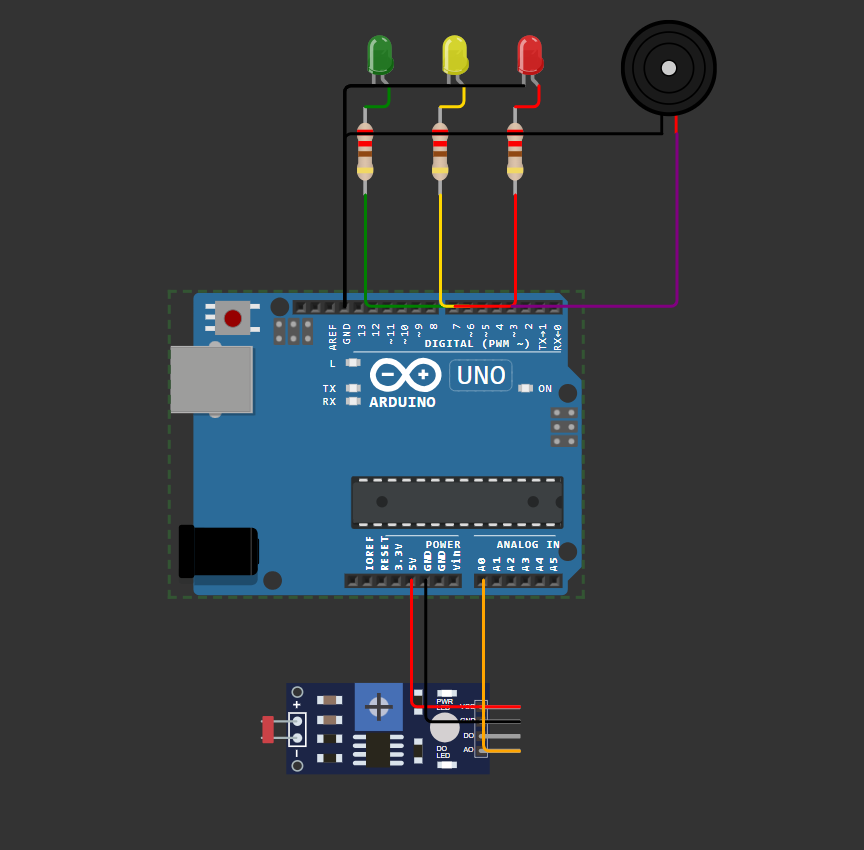
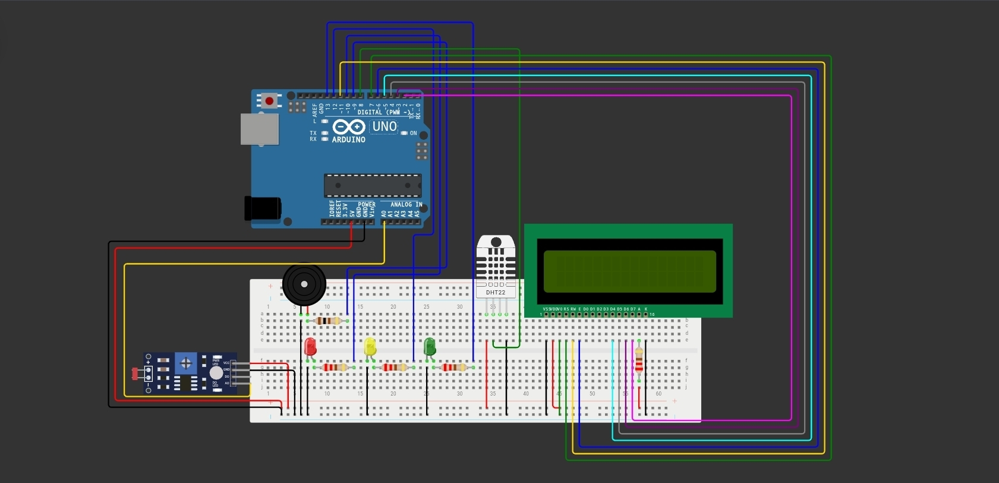
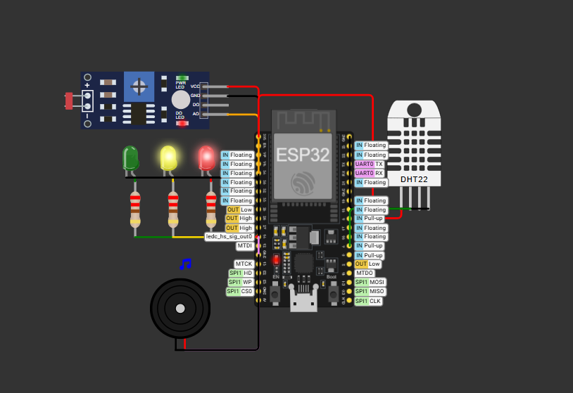

<div align="center">

# Vinheria Agnello

**Monitoramento ambiental da adega, do Arduino à nuvem**

Sistema que acompanha luminosidade, temperatura e umidade do local onde os vinhos ficam guardados e avisa em tempo real quando algum desses fatores sai da faixa ideal. O projeto evolui em três versões, de um circuito com um único sensor até uma solução IoT conectada ao FIWARE na AWS.


<sub>Edge Computing & Computer Systems · FIAP · Engenharia de Software</sub>

</div>

---

## Sobre o projeto

O vinho é sensível a três fatores do ambiente. O excesso de **luz** degrada compostos orgânicos, as variações de **temperatura** criam aromas indesejados e a **umidade** fora da faixa compromete rolhas e rótulos.

Para a Vinheria Agnello, desenvolvemos um sistema que mede esses três fatores continuamente e reage sozinho: LEDs mostram o estado do ambiente, um buzzer chama atenção quando algo está errado e, na versão IoT, os dados vão para a nuvem, onde ficam disponíveis em tempo real e com histórico.

### Evolução do projeto

| Versão | Placa | O que monitora | Novidade |
|---|---|---|---|
| **1. Luminosidade** | Arduino Uno | Luz | Alerta em três níveis com LEDs e buzzer |
| **2. Ambiental** | Arduino Uno | Luz, temperatura e umidade | Display LCD e média de 5 leituras para evitar oscilações |
| **3. IoT** | ESP32 | Luz, temperatura e umidade | Envio por Wi-Fi e MQTT para o FIWARE, com histórico e comandos remotos |

---

## Faixas ideais e alertas

| Fator | Faixa ideal | Fora da faixa |
|---|---|---|
| **Temperatura** | 10 °C a 15 °C | 🟡 LED amarelo, buzzer e `Temp. ALTA` ou `Temp. BAIXA` no display |
| **Umidade** | 50% a 70% | 🔴 LED vermelho, buzzer e `Umidade ALTA` ou `Umidade BAIXA` no display |
| **Luminosidade** | Escuro ou penumbra | Meia luz: 🟡 LED amarelo. Muito claro: 🔴 LED vermelho e buzzer |

Com tudo dentro da faixa, o **LED verde** fica aceso e o buzzer, desligado.

<sub>Faixa de temperatura segundo Alexander Pandell, PhD (UC). Faixa de umidade segundo recomendação geral de armazenamento.</sub>

---

## Versão 1 · Luminosidade

[](https://wokwi.com/projects/481301379218327553)



O módulo LDR envia a leitura de luz para a porta `A0`. O Arduino compara o valor com dois limites e acende o LED correspondente. Como o módulo entrega valores menores quando há mais luz, o código inverte a leitura (`1023 - analogRead(A0)`) para que valores altos signifiquem ambiente claro.

| Componente | Qtd. | Pino |
|---|---|---|
| Arduino Uno | 1 | — |
| Módulo LDR | 1 | A0 |
| LED verde, amarelo e vermelho + resistores 220 Ω | 3 | D5, D6, D7 |
| Buzzer passivo 5 V | 1 | D3 |

<details>
<summary><b>Como executar</b></summary>

**Wokwi:** abra a [simulação](https://wokwi.com/projects/481301379218327553), clique em **Play** e clique no sensor de luz para aumentar ou diminuir a luminosidade e testar os três estados.

**Hardware:** monte o circuito na protoboard, abra `circuito-01.ino` na Arduino IDE, faça o upload e acompanhe os valores no Monitor Serial (9600 baud).

</details>

---

## Versão 2 · Monitoramento ambiental

[](https://wokwi.com/projects/481301287920889857)



Além do módulo LDR, entra o sensor **DHT** para temperatura e umidade, e um **display LCD 16x2** mostra os valores. Para evitar alarmes falsos, o sistema usa a **média de 5 leituras** e atualiza a cada 5 segundos.

| Componente | Qtd. | Pino |
|---|---|---|
| Arduino Uno | 1 | — |
| Módulo LDR | 1 | A0 |
| Sensor DHT11 (DHT22 na simulação) | 1 | D8 |
| Display LCD 16x2 | 1 | D7, D11, D6, D5, D4, D3, D2 |
| LED verde, amarelo e vermelho + resistores 220 Ω | 3 | D13, D12, D10 |
| Buzzer passivo 5 V | 1 | D9 |

Bibliotecas: **DHT sensor library** (Adafruit) e **LiquidCrystal**.

<details>
<summary><b>Como executar</b></summary>

**Wokwi:** abra a [simulação](https://wokwi.com/projects/481301287920889857), clique em **Play** e altere os valores do DHT22 e do LDR para testar os alertas.

**Hardware:** instale a **DHT sensor library** na Arduino IDE (`Sketch > Include Library > Manage Libraries`), faça o upload de `circuito-02.ino` e acompanhe no Monitor Serial (9600 baud).

</details>

---

## Versão 3 · IoT com FIWARE

[](https://wokwi.com/projects/478084578183721985)



O **ESP32** mantém os alertas locais e passa a enviar as leituras por **Wi-Fi e MQTT** para um servidor **FIWARE** hospedado numa EC2 da AWS. Os dados ficam disponíveis em tempo real e com histórico, e o ESP32 também recebe comandos remotos.

### Arquitetura

```
ESP32 ──(Wi-Fi / MQTT)──► Mosquitto ──► IoT Agent MQTT ──(NGSIv2)──► Orion ──► STH-Comet (histórico)
                                                                       ▲
                                                    MyMQTT / Postman ──┘
```

- **Back-end FIWARE:** Orion Context Broker, IoT Agent MQTT, STH-Comet, MongoDB e Mosquitto, instalados com o [FIWARE Descomplicado](https://github.com/fabiocabrini/fiware).
- **Modelo de dados:** segue o Smart Data Model [IndoorEnvironmentObserved](https://github.com/smart-data-models/dataModel.Environment/tree/master/IndoorEnvironmentObserved), com `temperature` (°C), `relativeHumidity` (0 a 1) e `illuminance`.
- **Padrão NGSIv2:** os dados são consultados no Orion em `/v2/entities`, cada um com o horário da leitura (`TimeInstant`).
- **Histórico:** o STH-Comet guarda todas as leituras para consulta e gráficos.

### Tópicos MQTT

| Tópico | Função |
|---|---|
| `/TEF/vinheria001/attrs/t` | Temperatura (°C) |
| `/TEF/vinheria001/attrs/h` | Umidade (0 a 1) |
| `/TEF/vinheria001/attrs/l` | Luminosidade (%) |
| `/TEF/vinheria001/cmd` | Comandos: `vinheria001@on\|` liga e `vinheria001@off\|` desliga o LED da placa |

### Componentes

| Componente | Qtd. | Pino |
|---|---|---|
| ESP32 DevKit | 1 | — |
| Sensor DHT11 (DHT22 na simulação) | 1 | GPIO 4 |
| Módulo LDR | 1 | GPIO 34 |
| LED verde, amarelo e vermelho + resistores 220 Ω | 3 | GPIO 25, 26, 27 |
| Buzzer | 1 | GPIO 14 |

Bibliotecas: **DHT sensor library** (Adafruit) e **PubSubClient**. App: **MyMQTT** (Android e iOS).

<details>
<summary><b>Como executar</b></summary>

**1. Servidor FIWARE**
1. Ligue o servidor na AWS com `sudo docker compose up -d`, com as portas **1026**, **4041**, **8666** e **1883** liberadas.
2. Importe `circuito-03.postman_collection.json` no Postman e troque a variável `url` pelo IP do servidor.
3. Rode as requisições **1 a 3** (health checks) e, uma única vez, as **4 a 6** (serviço, dispositivo e histórico).

**2. ESP32**
- **Wokwi:** abra a [simulação](https://wokwi.com/projects/478084578183721985) e clique em **Play**. O Monitor Serial mostra `Conectado!` e os valores a cada 5 segundos.
- **Hardware:** instale o suporte ao ESP32 e as bibliotecas na Arduino IDE, troque o Wi-Fi pela sua rede 2,4 GHz e `DHT22` por `DHT11` em `circuito-03.ino`, selecione **ESP32 Dev Module** e faça o upload (Monitor Serial em 115200 baud).

**3. MyMQTT**
- Conecte no IP do servidor, porta `1883`.
- **Leitura:** inscreva-se em `/TEF/vinheria001/attrs/#`.
- **Comando:** publique `vinheria001@on|` em `/TEF/vinheria001/cmd` para acender o LED da placa.

**4. Consultas no Postman**
- **7:** últimos valores no Orion, com o horário de cada leitura.
- **8 e 9:** ligam e desligam o LED da placa pelo Orion.
- **10 a 12:** histórico de temperatura, umidade e luminosidade no STH-Comet.

</details>

---

## Ajuste dos limites

Os limites de cada alerta ficam no início dos arquivos `.ino` e podem ser calibrados para o ambiente real. Use o Monitor Serial para ver os valores brutos dos sensores.

```cpp
// circuito-01.ino: luminosidade (leitura analógica de 0 a 1023)
int limiteOK     = 880;  // abaixo: ambiente escuro
int limiteAlerta = 960;  // entre os dois: meia luz / acima: muito claro

// circuito-02.ino e circuito-03.ino: temperatura (°C) e umidade (%)
const int TEMP_MIN = 10;
const int TEMP_MAX = 15;
const int UMID_MIN = 50;
const int UMID_MAX = 70;
```

---

## Estrutura

```
Vinheria-Agnello/
├── circuito-01.ino                       # Versão 1: luminosidade
├── circuito-01.png
├── circuito-02.ino                       # Versão 2: luminosidade, temperatura e umidade com LCD
├── circuito-02.jpg
├── circuito-03.ino                       # Versão 3: ESP32 com Wi-Fi e MQTT
├── circuito-03.png
├── circuito-03.postman_collection.json   # Requisições do FIWARE
└── README.md
```

---

## Equipe

| Nome | RM |
|---|---|
| Eric Kang | 572575 |
| Guilherme Tomé Nogueira | 570144 |
| Lucas de Andrade Astorini | 569119 |
| Sabrina Lopes da Silva | 571870 |
| Sofia Satomi Hagio | 569120 |
